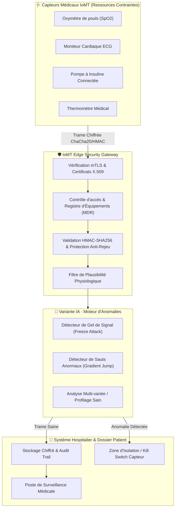

# 🏗️ Architecture Technique - Protection des Objets Connectés Médicaux

---

## 🔒 Principes d'Ingénierie Sécurité

1. **Zero Trust Architecture (ZTA) :** Aucun dispositif n'est considéré de confiance par défaut, même situé au sein du réseau local de l'établissement de santé.
2. **Cryptographie adaptée aux contraintes matérielles :** Utilisation de ChaCha20-Poly1305 pour éviter la surcharge processeur et l'épuisement de batterie.
3. **Quarantaine automatisée :** Tout capteur présentant un comportement de signal aberrant est automatiquement isolé pour protéger le patient.
